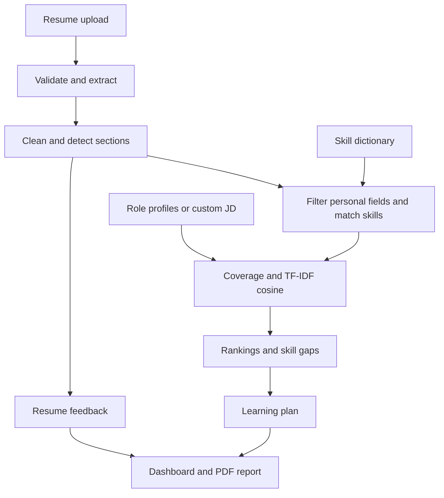

# CareerLens

## AI Resume Analyzer and Job Recommendation System

CareerLens turns a PDF or DOCX resume into an explainable view of documented technical skills, suitable role profiles, gaps and a learning plan. It implements all seven modules in the supplied major-project specification and runs locally without an API key, database or downloaded model.

Built for educational career guidance. Scores are not hiring probabilities or recruiter decisions.

## Start on Windows

Install **Python 3.12**, extract this complete folder, then double-click **`start_windows.bat`**. The first launch installs dependencies and opens Streamlit. Keep the terminal open while using the app. Internet is needed for the initial installation; analysis then runs locally.

Or open PowerShell in this folder and paste these commands one line at a time:

```powershell
py -3.12 -m venv .venv
.\.venv\Scripts\python.exe -m pip install -r requirements.txt
.\.venv\Scripts\python.exe -m streamlit run app.py
```

Open **http://localhost:8501** if the browser does not open automatically. These commands do not require activating the environment or changing PowerShell execution policy.

## Start on macOS or Linux

```bash
python3.12 -m venv .venv
.venv/bin/python -m pip install -r requirements.txt
.venv/bin/python -m streamlit run app.py
```

Alternatively run `sh start_unix.sh`. Use Python 3.12, the tested version. A full transitive lock is provided in `requirements.lock.txt`; replace `requirements.txt` with this filename to reproduce the recorded runtime dependency versions.

## Example walkthrough

1. Click **Try Data Analyst**, or upload a readable PDF/DOCX and click **Analyze resume**.
2. Choose a target job role. The target score and gaps update without another upload.
3. Inspect the top three recommendations and all 13 role scores.
4. Open **Skills & gaps** to check detected terms and where they occur.
5. Open **Learning plan** for prerequisite-first topics, official resources and practice tasks.
6. Use **Resume insights** to review feedback and the original extracted text.
7. Paste or upload `sample_resumes/custom_job.txt` in **Custom job** and click **Compare with job description**.
8. In **Report**, choose the target, click **Prepare PDF report**, then **Download analysis PDF**.
9. Use **Clear session** to discard uploads and results.

## Problem and objectives

Students often cannot tell which job-related skills their resumes communicate or what to learn for a target role. CareerLens makes this comparison inspectable, shows missing terminology without equating it with missing ability, and turns gaps into concrete study and project tasks.

## Implemented features

- PDF and DOCX upload, filename/size feedback, replace/remove controls and validation.
- Every readable PDF page; DOCX paragraphs, tables, nested tables and header text.
- Technical punctuation preserved, including C++, C#, .NET, Node.js and CI/CD.
- 110 canonical skills, aliases, categories and section-based evidence labels.
- 13 curated role profiles, including all five mandatory roles.
- Deterministic hybrid coverage + TF-IDF cosine scores, top-three recommendations and Plotly charts.
- Required/preferred gaps, dependency-ordered roadmaps and a role-specific capstone.
- Summary, skills, education, experience, internships, projects, certifications and achievements sections.
- Rule-based resume feedback and custom job-description comparison.
- In-memory PDF reports, privacy controls, synthetic fixtures, automated tests and an evaluation sheet.

## Seven modules and architecture

| Module | Implementation |
| --- | --- |
| Resume upload | `app.py`, `src/resume_parser.py` |
| Extraction and cleaning | `src/resume_parser.py`, `src/text_cleaner.py` |
| Skill extraction | `src/skill_extractor.py`, `src/section_detector.py` |
| Job-role dataset | `data/*.csv`, `src/datasets.py` |
| Matching and recommendation | `src/job_matcher.py`, `src/pipeline.py` |
| Skill gaps and roadmap | `src/roadmap_generator.py`, fields on each Match |
| Streamlit dashboard | `app.py`, `src/ui.py`, `src/charts.py`, `src/report_generator.py` |



The full diagram source is `docs/architecture.mmd`; the export is `docs/architecture.svg`.

## Technology stack

Python 3.12, Streamlit, pypdf, python-docx, scikit-learn, Plotly, ReportLab and python-dotenv. Pytest and Ruff are development tools. No paid LLM, embeddings, FastAPI backend or database is required. Those were optional in the specification; the implemented design prioritizes a reproducible, self-contained analysis path.

## Matching methodology

For a role with preferred skills:

`score = round(75 × core_coverage + 15 × preferred_coverage + 10 × cosine_similarity, 1)`

All inputs are fractions in [0, 1]. For a role without preferred skills, the formula is `90 × core_coverage + 10 × cosine_similarity`.

Aliases normalize to canonical skill names. Each skill becomes a unique binary token. `TfidfVectorizer` is fitted **once on the 13 role profiles**, using a fixed skill vocabulary, binary term frequencies, smooth IDF and L2 normalization. For each target, the resume's vector contains only detected skills in that target's core/preferred set. Both vectors use identical IDF weights. The resulting cosine is the square root of the fraction of the target's squared IDF weight detected in the resume.

This projection is deliberate: unrelated skills cannot dilute the score, repeating keywords earns no points, and adding a relevant skill cannot reduce a component. The method is lexical skill similarity, not a claim of semantic understanding. Rankings use score, then core coverage, then alphabetical role name for deterministic ties. With no detected skills, all scores are zero and the interface explicitly says the ranking is uninformative.

Project/work mentions are shown as contextual evidence but do not add score weight. Education and certifications are shown and considered in section feedback, not scored. No degree prestige, tenure estimate or protected-attribute feature enters the score.

## Skill gaps and roadmaps

Core and preferred requirements are compared separately. A missing skill means **not detected in the uploaded resume**. The plan visits missing core skills in learning-stage order, recursively places missing prerequisites first, skips all already-detected topics and ends with a project for the selected role. A toggle includes missing preferred skills. Suggested weeks are flexible 5-8 hour study blocks, not a mastery guarantee.

## Environment configuration

Nothing is required. To customize the upload cap, copy `.env.example` to `.env` and set `MAX_UPLOAD_MB` (1-10, default 5). Invalid values fall back safely. The server upload ceiling is 10 MB in `.streamlit/config.toml`; application validation may be stricter. PDF page count is capped at 20 and extracted text at 150,000 characters. A custom JD is capped at 30,000 characters.

`.env` and `.streamlit/secrets.toml` are ignored by Git and Docker. There are no API key fields because no external inference service is implemented.

## Privacy, security and responsible AI

Uploaded bytes, text, analysis and reports remain in the active session's memory. They are never written to an application database or temporary upload files, and are not passed to shared data caches. Only public datasets and the vectorizer are cached. The code does not log resume contents. **Clear session** discards application references and resets upload widgets; process memory release and disconnected-session cleanup are managed by Python/Streamlit, not a secure memory erasure guarantee. Hosting providers can keep ordinary infrastructure logs.

Parsing validates extension, signatures, size, page count, readable text and DOCX archive expansion. Macros and encrypted PDFs are rejected. PDF decompression is bounded. User strings are escaped for HTML/PDF output, and filenames are sanitized. CORS and XSRF protection remain enabled. Docker runs as an unprivileged user. For internet-scale adversarial traffic, add platform rate limits and isolated parser workers; those are not included here.

Gender, age, religion, nationality, photographs, marital status and disability are not scoring features. Recognized personal fields/sections and structured-document preambles are excluded from skill extraction. Unsectioned documents fall back to non-personal text. These rules reduce leakage; they do not prove statistical fairness across populations. Do not use this tool for automated hiring, rejection or eligibility decisions.

## Tests and evaluation

```powershell
.\.venv\Scripts\python.exe -m pip install -r requirements-dev.txt
.\.venv\Scripts\python.exe -m pytest -q
.\.venv\Scripts\python.exe -m ruff check .
.\.venv\Scripts\python.exe scripts/evaluate.py
```

On macOS/Linux, replace `.\.venv\Scripts\python.exe` with `.venv/bin/python`.

The tests cover document extraction, invalid/oversized/encrypted/scanned files, technical punctuation, aliases and boundaries, scoring bounds and monotonicity, counterfactual protected fields, JD parsing, dependencies, feedback, PDF output, Streamlit navigation, report preparation and session clearing.

`reports/evaluation.csv` records expected/actual roles and skill precision/recall on three manually labelled fictional profiles exported in two formats, plus four direct-text probes. `reports/evaluation_summary.json` contains aggregate results. These fixtures are deliberately small and authored for this project; perfect fixture scores must not be presented as real-world resume accuracy. See `docs/VERIFICATION.md` for checks actually executed and external limitations.

## Docker

```bash
docker build -t careerlens .
docker run --rm -p 8501:8501 -e MAX_UPLOAD_MB=5 careerlens
```

Or `docker compose up --build`. The container exposes port 8501 and checks `/_stcore/health`. No persistent volume is needed. The Compose configuration adds a read-only root filesystem, temporary `/tmp` and reduced privileges. See verification notes for whether Docker itself was available during handoff.

## Deployment

For Streamlit Community Cloud, put this folder's contents at the root of a GitHub repository, choose `app.py` as the entrypoint and Python 3.12 in deployment settings. The included `requirements.txt` supplies dependencies. No secrets are required. For Render, use `render.yaml` or set the build command to `pip install -r requirements.lock.txt` and the start command to `python -m streamlit run app.py --server.address=0.0.0.0 --server.port=$PORT`.

Detailed steps and external account requirements are in `docs/DEPLOYMENT.md`. A deployment configuration is not proof of a live deployment; only a verified published URL counts as deployed.

## Project structure

| Path | Purpose |
| --- | --- |
| `app.py` | Streamlit entrypoint |
| `src/` | Parsing, extraction, matching, roadmap, feedback, reports and UI helpers |
| `data/` | Skill and role CSVs |
| `sample_resumes/` | Three fictional profiles in PDF/DOCX/TXT and a custom JD |
| `tests/` | Automated tests |
| `scripts/` | Sample generation, evaluation and browser verification |
| `reports/` | Evaluation results and an example PDF analysis |
| `docs/` | Project report, viva, architecture, demonstration and deployment guides |
| `assets/` | Responsive dashboard styling |
| `.streamlit/` | App theme, upload and privacy settings |
| `.github/workflows/` | Automated test workflow |
| `Dockerfile`, `compose.yaml`, `render.yaml` | Deployment configuration |
| `start_windows.bat`, `start_unix.sh` | Convenience launchers |

## Screenshots and demonstration

See `docs/screenshots/` for captured application views and `docs/demo/CareerLens_Demo.mp4` for the 2 minute 54 second silent browser recording, slowed for readability. `docs/DEMO.md` supplies a presentation script. The verification record states which browser checks ran. The project does not use mock screenshots to imply a tested live application.

PDF fonts are bundled in `assets/fonts/`. Their upstream license is included in `assets/fonts/copyright`.

## Known limitations and future work

- English technical resumes only; not a general assessment of non-technical occupations.
- No OCR, image analysis or recovery of text embedded only in DOCX drawing objects/tracked revisions. Multi-column PDF order may be imperfect.
- A controlled dictionary cannot infer every synonym, skill equivalence, proficiency or nuanced negation. Review extracted text and JD requirements.
- Structured document headers before the first recognized section are ignored for scoring, reducing name/contact leakage but sometimes omitting a headline skill.
- Curated roles are not vacancies; requirements vary across employers and levels. No live job feed is implemented.
- No hiring-outcome calibration, independent fairness audit, external benchmark or long-term storage.
- Future work: consented labelled evaluation, dictionary review, isolated OCR, retrieval-quality comparisons, multilingual extraction, and optional user-controlled semantic feedback.

## References

Official project guidance supplied with the assignment is the requirements source. Implementation references: [Streamlit documentation](https://docs.streamlit.io/), [pypdf extraction](https://pypdf.readthedocs.io/en/latest/user/extract-text.html), [python-docx document API](https://python-docx.readthedocs.io/en/latest/api/document.html), [scikit-learn TF-IDF](https://scikit-learn.org/stable/modules/generated/sklearn.feature_extraction.text.TfidfVectorizer.html), [cosine similarity](https://scikit-learn.org/stable/modules/generated/sklearn.metrics.pairwise.cosine_similarity.html), [Dockerfile reference](https://docs.docker.com/reference/dockerfile/). Dataset context is in `docs/DATASET_NOTES.md`.
